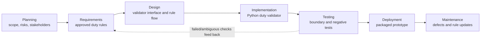

# L1.1 – SDLC Phases and Deliverables

## Requirement

Draw the SDLC phases for Airline Crew Scheduling and provide one output per phase.

## Case-specific diagram

## Phase deliverables

| SDLC phase | Airline Crew Scheduling deliverable |
|---|---|
| Planning | Scope, stakeholders, risk list and prototype milestone |
| Requirements | Approved daily/rest/rolling-seven-day constraints and input/output contract |
| Design | Validator flow, API/CLI interface decision and rule precedence |
| Implementation | `duty_validator.py` |
| Testing | `test_duty_validator.py`, `test_ai_generated.py`, and recorded test results |
| Deployment | Packaged Python prototype and deployment instructions (not a production deployment) |
| Maintenance | Defect log and controlled changes when approved rules change |

## Evidence and status

This is the completed lab diagram/table artifact. Existing `L1.1_01_Tool_Versions.png.png` through `L1.1_05_Requirements.png..png` are setup/Flask screenshots, not proof of this diagram; none is reused as such. The feedback loop is shown as a dotted Testing-to-Requirements arrow. The duty limits remain sample assumptions pending official confirmation.

**Status: COMPLETE** for the requested diagram and deliverables table. No screenshot was captured.
